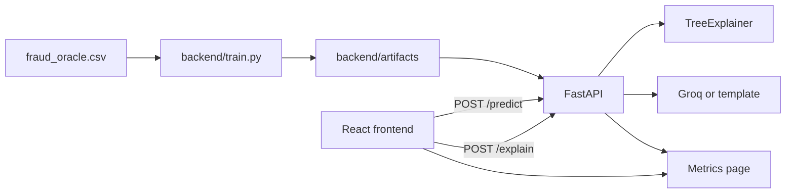

# Insurance Claim Fraud Detector

AI-powered fraud scoring with **Low / Medium / High** risk bands and **SHAP** explainability. Built for imbalanced data with **recall** and **precision-recall AUC** — not vanity accuracy.

Screening aid for vehicle insurance claims (SIU / adjuster triage). Not an automated decision-maker.

**Live demos**
- Frontend (Vercel): _add after deploy_
- API (Hugging Face Spaces): _add after deploy_

## Why this project

Fraud is rare (~6% in the training data). A model that always predicts “not fraud” is ~94% accurate and catches **zero** fraud. This app optimizes and reports the metrics that matter for screening:

| Metric (held-out test) | Value |
|---|---:|
| Positive rate / baseline PR-AUC | 0.060 |
| 5-fold CV PR-AUC (train only) | 0.238 |
| Test PR-AUC | 0.233 |
| Medium-band recall | 0.903 |
| Medium-band precision | 0.132 |
| High-band precision | 0.500 |
| High-band recall | 0.054 |
| Confusion matrix @ medium (TN, FP, FN, TP) | 1801, 1098, 18, 167 |

**Risk bands** (chosen from the PR curve, not a naive 0.5 cutoff):

| Band | Rule (this train) | Intent |
|---|---|---|
| High | probability ≥ 0.850 | Precision-oriented queue for SIU |
| Medium | probability ≥ 0.112 | ~90% recall catch-net |
| Low | below medium | Standard path + audit sampling |

## Features

- **Score page** — claim form, load sample claims, risk gauge, top-6 SHAP bar chart (red → toward fraud, blue → away)
- **AI explanation** — optional Groq narrative after the score; template fallback if no API key
- **Metrics page** — live recall, precision, PR-AUC vs baseline, confusion matrix, PR curve, “why not accuracy” note
- **FastAPI** — `/health`, `/metrics`, `/samples`, `/predict`, `/explain`
- **Honest ML** — sklearn Pipeline (impute + encode + LightGBM class weights), stratified split, 5-fold CV on train only, no ID leakage

## Stack

- **ML / API:** Python, scikit-learn, LightGBM, SHAP, FastAPI, joblib
- **UI:** React, TypeScript, Vite, Tailwind CSS, Recharts
- **Deploy:** Docker API on Hugging Face Spaces (port 7860), frontend on Vercel

## Architecture



## Feature handling

| Column | Action | Reason |
|---|---|---|
| `PolicyNumber` | Drop | Unique ID / leakage |
| `RepNumber` | Drop | Adjuster identity, not claim content |
| `AgeOfPolicyHolder` | Drop | Redundant bins of age |
| `Age` | Keep numeric | Zeros treated as missing |
| `Year` | Keep ordinal | Claim-year context |

## Project layout

```
backend/train.py           # train + write artifacts
backend/main.py            # FastAPI app
backend/llm_explain.py     # Groq + template fallback
backend/artifacts/         # model.joblib, metrics, PR curve, samples, thresholds
frontend/                  # Vite React app
tests/test_api.py          # pytest for /predict and band logic
Dockerfile                 # HF Spaces (port 7860)
requirements.txt
```

## Local setup

```bash
# Python
python -m pip install -r requirements.txt

# Data (gitignored): place Kaggle vehicle insurance fraud CSV at
#   data/raw/fraud_oracle.csv
# Train (writes backend/artifacts/*)
python backend/train.py

# API
uvicorn backend.main:app --reload --port 8000

# Frontend (other terminal)
cd frontend
cp .env.example .env   # VITE_API_URL=http://127.0.0.1:8000
npm install
npm run dev
```

```bash
python -m pytest tests/test_api.py -q
```

Optional local LLM explanations:

```bash
# .env in repo root (never commit)
GROQ_API_KEY=your_key_here
```

## API

| Method | Path | Body / notes | Response highlights |
|---|---|---|---|
| GET | `/health` | — | `{ "status": "ok" }` |
| GET | `/metrics` | — | metrics, PR curve, thresholds |
| GET | `/samples` | — | 6 held-out claims (2 per band) |
| POST | `/predict` | claim JSON | `probability`, `band`, `top_contributions` |
| POST | `/explain` | score + SHAP payload | `explanation`, `source` (`groq` \| `template`) |

## Deploy

### 1) Backend — Hugging Face Spaces (Docker)

1. Create a Space → **Docker** SDK → hardware CPU is fine.
2. Connect this GitHub repo (or push `Dockerfile`, `requirements.txt`, `backend/` with **artifacts**).
3. Space runs: `uvicorn backend.main:app --host 0.0.0.0 --port 7860`.
4. **Groq key (optional):** Space → **Settings** → **Variables and secrets** → **New secret**
   - Name: `GROQ_API_KEY`
   - Value: your key from https://console.groq.com/keys  
   Without it, `/explain` still works via the built-in template.
5. After the Space is live, copy its public URL (e.g. `https://USERNAME-SPACE_NAME.hf.space`).

### 2) Frontend — Vercel

1. Import the GitHub repo in Vercel.
2. **Root Directory:** `frontend`
3. Framework: Vite (default build `npm run build`, output `dist`)
4. Environment variable (Production + Preview):
   - `VITE_API_URL` = your Hugging Face Space URL **with no trailing slash**
5. Deploy. Open the Vercel URL and use Score + Metrics.

Rebuild the frontend whenever `VITE_API_URL` changes (it is baked in at build time).

## Model card

- **Data:** Kaggle-style vehicle insurance claim fraud (`FraudFound_P`), 15,420 rows, ~5.99% positive.
- **Model:** `Pipeline` → median/most-frequent impute → ordinal + one-hot encode → `LGBMClassifier` with `scale_pos_weight`.
- **Validation:** stratified 80/20 holdout; 5-fold stratified CV probabilities on **train only**.
- **Intended use:** human-in-the-loop **screening**.
- **Not for:** automatic denial, pricing, or accusing customers.
- **Limits:** public labels ≠ your book of business; recalibrate thresholds on your data; SHAP explains the model, not truth.
- **Fairness:** `Sex`, `Age`, `MaritalStatus` can be sensitive — run disparate-impact review before production; prefer claim-process features where possible.

## License / secrets

- Do not commit `.env`, raw `data/raw/`, or API keys.
- `GROQ_API_KEY` belongs only in HF Space secrets (or local `.env`).
